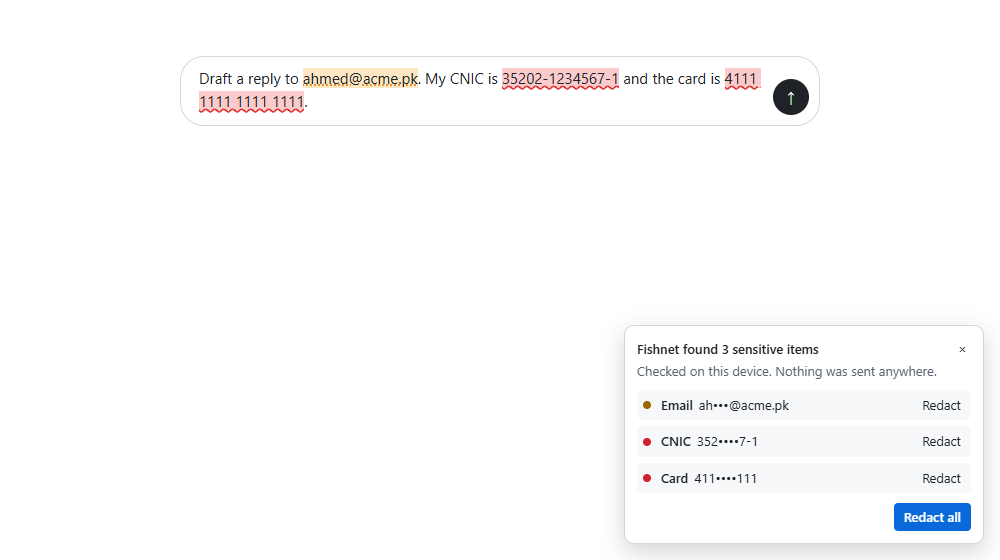
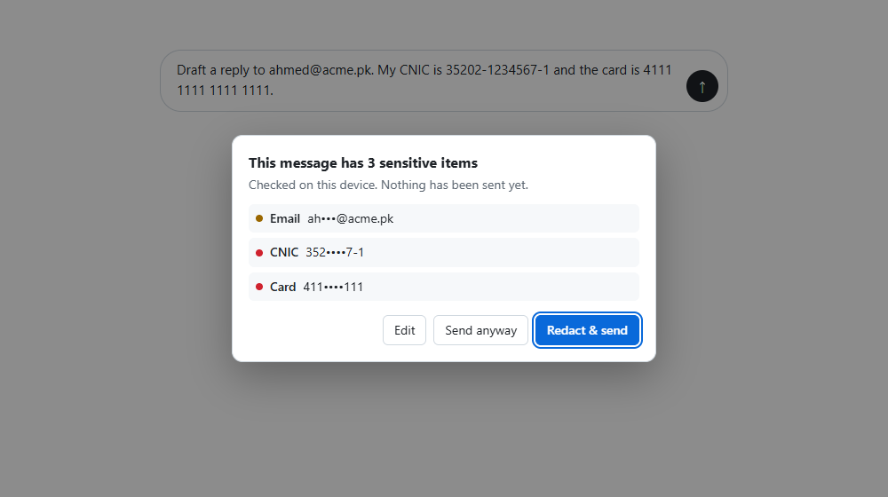
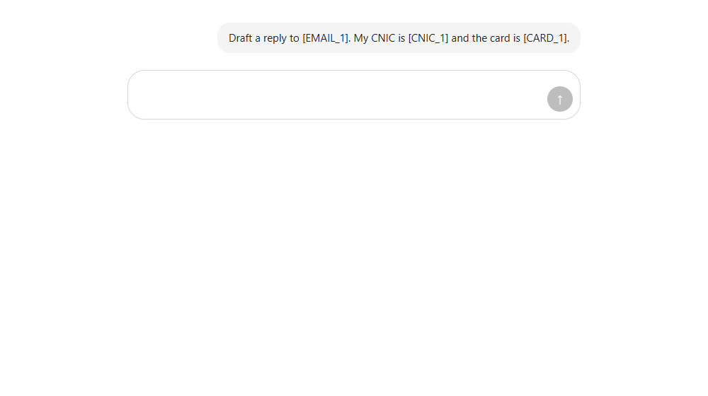
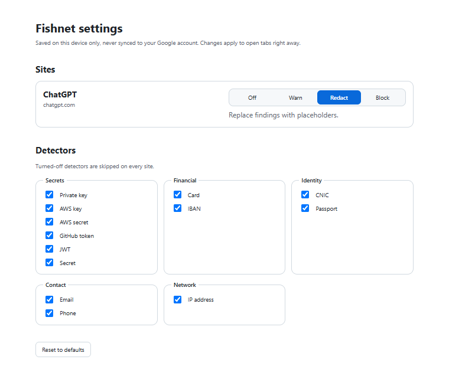
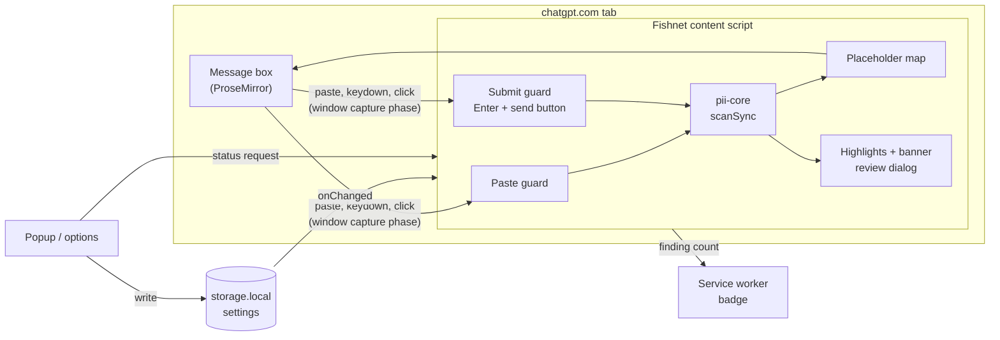

# Fishnet

Chrome extension that catches PII and secrets before you send them to AI tools. It finds emails, phone numbers, cards, CNICs, API keys and more in the ChatGPT message box, and swaps them for placeholders such as `[EMAIL_1]` before anything is sent. Everything runs in your browser; no data leaves the device.



Status: v0.1.0, ChatGPT only. See [PLAN.md](PLAN.md) for the roadmap and [PRIVACY.md](PRIVACY.md) for what the extension reads and stores.

## What it does

- **Highlights** sensitive items as you type (red for secrets and IDs, amber for contact details) and lists them in a banner with masked previews, safe to have on screen while sharing it.
- **Redacts pastes** before the editor sees them. Undo still works.
- **Checks every send** (Enter or the send button) and acts according to the mode for the site.
- **Keeps placeholders consistent**: the same email is `[EMAIL_1]` every time in a conversation.

| Mode | On paste | On send |
|---|---|---|
| Off | Nothing | Nothing |
| Warn | Let through, highlight | Send as typed |
| Redact (default) | Insert placeholders | Replace findings, then send |
| Block | Stop the paste | Ask: Redact & send, Send anyway, or Edit |

Clean messages are never delayed: the check is synchronous and takes a few milliseconds.

| Review before sending (block mode) | What ChatGPT receives (redact) |
|---|---|
|  |  |

Mode per site and each detector can be changed from the popup or the options page; changes apply to open tabs without a reload.



Screenshots are taken from the local test page used by the end-to-end tests, not from chatgpt.com.

## How it works



- Listeners sit on `window` in the capture phase, so they run before the site's own editor handlers.
- Detection is synchronous regex with validation (Luhn, mod-97, JWT header decode), so the allow/block decision fits inside a `keydown` handler.
- Placeholders are inserted with `execCommand('insertText')` or a synthetic paste, which editors like ProseMirror treat as user input, so their state and undo history stay correct.
- Highlights use the CSS Custom Highlight API, which paints over text without touching the editor's DOM. The banner and dialog live in closed shadow roots.
- Each site has one adapter file with its selectors and fallbacks. The popup warns when the adapter cannot find the message box.

## What it detects

| Kind | Types | How |
|---|---|---|
| Contact | Email, phone (PK default, international) | Regex; phones parsed with libphonenumber-js |
| Financial | Credit card, IBAN | Luhn + issuer prefix; mod-97 + country length |
| Identity | CNIC, passport | Format + province code; passport only next to a context word |
| Network | IPv4, IPv6 | Octet / group validation, version strings excluded |
| Secrets | AWS keys, GitHub tokens, JWT, private keys, `KEY=value` secrets | Prefix patterns, JWT header decode, value-only spans |

Names, organisations and places are not detected yet (planned in-browser NER, v3).

## Benchmark

`pnpm bench` scores the detectors against `bench/data` and fails if any type's F1 drops more than 2 points below `bench/baseline.json`.

Current results (v0 datasets: 150 synthetic + 39 hand-labelled prompts, 50 negatives):

| Metric | Value |
|---|---|
| Precision / recall (all supported types) | 100% / 100% |
| False alarms on negatives | 0 per 1,000 words |
| `scanSync` latency, 10 KB input | ~6 ms p50, ~8 ms p95 |

These numbers are optimistic. The same person wrote the detectors and the test data, and both datasets are small. Treat them as a regression guard, not a claim of real-world accuracy. A larger hand-labelled set written by someone else is the next step.

## Limits

- A safety net, not data loss prevention. It will miss things, and anything it misses is sent as typed.
- ChatGPT only. Site changes can break the adapter; the popup says when the message box cannot be found.
- Not covered: drag and drop, file uploads, images of text, the desktop and mobile apps.
- Regex cannot catch free-form secrets ("my password is hunter2") or names.
- US-style phone numbers without a `+`, leading `0` or a context word are skipped on purpose, to avoid flagging order numbers.
- Placeholders are not yet restored in ChatGPT's replies (v2), and the AI may reword them.
- Not yet tested on the live chatgpt.com in CI: the end-to-end tests run against a local ProseMirror page with the same markup.

## Setup

No store listing yet. To try it:

```sh
pnpm install
pnpm build
```

Then open `chrome://extensions`, turn on Developer mode, choose **Load unpacked** and select `apps/extension/.output/chrome-mv3`.

## Development

```sh
pnpm dev          # opens Chrome with the extension loaded and hot reload
pnpm test         # unit tests (pii-core and extension)
pnpm e2e          # Playwright end-to-end tests against a local ChatGPT stand-in
pnpm bench        # accuracy benchmark (add --verbose to list misses)
pnpm bench:gen    # rebuild bench/data from the generator and handlabeled.src.txt
pnpm lint         # Biome
pnpm typecheck
pnpm build
pnpm --filter @fishnet/extension screenshots   # refresh docs/images
```

CI runs lint, typecheck, unit tests, the benchmark, a build and the end-to-end tests on every push.

```
packages/pii-core   detection engine and reversible redaction, no browser APIs
apps/extension      WXT extension: content script, service worker, popup, options
bench/              datasets, generator and benchmark runner
```

Detector patterns draw on ideas from [Microsoft Presidio](https://github.com/microsoft/presidio) and [gitleaks](https://github.com/gitleaks/gitleaks).
